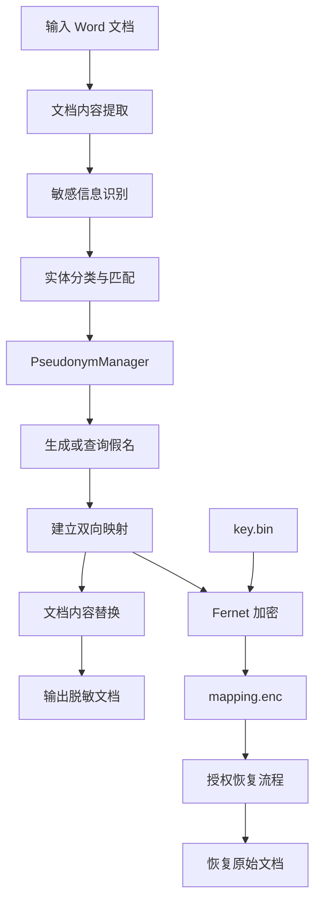
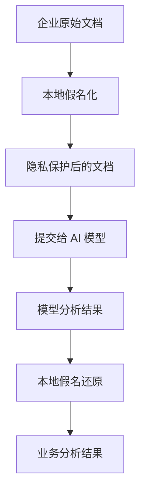

# 基于可逆假名化的文档隐私保护工具

将文档中的敏感信息替换为稳定的虚拟身份，在保护真实数据隐私的同时，保留数据关联性与可恢复能力。

---

## 1. 项目简介

**Project Dynamic Data Masking** 是一个基于 Python 开发的文档敏感信息假名化工具，主要用于解决企业文档在共享、测试、分析和 AI 处理过程中面临的隐私泄露问题。

在合同、客户资料、业务报告等文档中，通常包含姓名、身份证号码、手机号码、邮箱、地址以及企业身份信息等敏感数据。

直接共享原始文档可能造成个人隐私泄露和商业信息暴露，而简单地使用 `******` 替换敏感信息，又会破坏文档原有的数据关联关系。

本项目采用 **可逆假名化（Reversible Pseudonymization）** 技术，通过敏感信息识别、确定性假名生成、双向映射和加密存储，实现：

- 自动识别文档中的敏感信息。
- 将真实身份信息替换为稳定的虚拟身份。
- 保持同一实体在文档中的一致性。
- 使用加密映射表保护真实信息与假名之间的对应关系。
- 在获得授权和密钥的前提下恢复原始数据。
- 尽量保留原始 Word 文档的内容结构与格式。

### 设计目标

本项目希望在三个方面取得平衡：

| 目标 | 说明 |
|---|---|
| 隐私保护 | 避免真实身份信息直接暴露 |
| 数据可用性 | 保留数据之间的关联关系 |
| 数据可恢复性 | 支持通过受保护的映射关系恢复原始内容 |

**项目定位：文档隐私保护与可逆假名化工具。**

需要注意，本项目目前并不是数据库动态脱敏中间件，也不提供数据库 SQL 拦截、实时字段权限控制等功能。

---

## 2. 核心功能

### 2.1 敏感信息自动识别

项目通过正则表达式和中文分词技术识别文档中的敏感实体。

当前覆盖以下七类信息：

| 类型 | 标识 | 识别对象 | 示例 |
|---|---|---|---|
| 姓名 | NAME | 自然人姓名 | 张三 |
| 身份证号 | ID | 身份证号码 | 320101199001011234 |
| 手机号 | PHONE | 手机号码 | 13812345678 |
| 邮箱 | EMAIL | 电子邮箱 | zhangsan@example.com |
| 地址 | ADDRESS | 联系地址 | 示例省示例市示例路 |
| 机构名称 | ORG | 企业或组织名称 | 示例科技有限公司 |
| 统一社会信用代码 | USCC | 企业统一社会信用代码 | 统一社会信用代码 |

识别技术：

- 正则表达式：用于匹配格式相对固定的敏感数据。
- jieba：辅助中文文本分词及实体识别。
- 实体类型管理：按照敏感信息类别组织识别和替换逻辑。

### 2.2 确定性假名化

本项目采用稳定的假名映射机制，而不是简单地随机替换字符串。

例如，原始文档：

```text
甲方：张三
联系电话：13812345678

乙方：张三
联系人：张三
```

假名化后：

```text
甲方：李四
联系电话：13900001234

乙方：李四
联系人：李四
```

以上仅为示意数据，实际生成结果取决于项目的假名生成逻辑。

核心特点：

- 相同的真实实体在同一映射上下文中使用相同假名。
- 不同实体具有独立的映射关系。
- 支持双向查询。
- 保持文档中实体之间的关联性。

### 2.3 双向映射与数据恢复

系统维护真实值与假名之间的双向映射：

```text
真实数据                    假名数据

张三          <------->     李四
13812345678   <------->     13900001234
```

映射关系支持两个方向：

```text
Anonymize:
真实数据 -> 假名数据

Restore:
假名数据 -> 真实数据
```

因此，处理后的文档既可以用于数据共享，也可以在受控环境下恢复原始信息。

### 2.4 加密映射表

为了避免真实身份信息以明文形式保存在映射文件中，项目使用 Python `cryptography` 库提供的 Fernet 机制加密映射表。

数据文件：

```text
data/
├── mapping.enc    # 加密后的假名映射表
└── key.bin        # Fernet 加密密钥
```

安全设计：

- 映射关系以加密形式保存。
- 不直接将真实值和假名的对应关系写入明文文件。
- 密钥与映射文件分开存储。
- 审计日志记录操作类型、敏感信息类别及数量。
- 审计日志不记录原始敏感文本或假名。
- 清理命令会同时删除映射表和密钥。

**注意：映射文件和密钥必须受到严格保护。** 两者同时泄露可能导致原始敏感数据被恢复。

---

## 3. 系统架构

项目采用模块化设计，将敏感信息识别、假名映射、加密存储和文档处理等职责分离。

### 3.1 整体处理流程



### 3.2 核心模块职责

| 模块 | 主要职责 |
|---|---|
| 敏感信息识别模块 | 识别姓名、电话、证件号码等敏感实体 |
| PseudonymManager | 管理假名生成、双向映射和查询 |
| 文档处理模块 | 读取文档、替换文本、保存结果 |
| 加密存储模块 | 加密和读取映射关系 |
| 审计模块 | 记录脱敏与恢复操作 |
| CLI 模块 | 提供命令行操作入口 |
| GUI 模块 | 提供图形化操作入口 |

### 3.3 技术栈

| 技术 | 用途 |
|---|---|
| Python 3.10+ | 核心开发语言 |
| python-docx | Word 文档读取与处理 |
| jieba | 中文分词 |
| cryptography | Fernet 对称加密 |
| PyMuPDF | PDF 相关文档处理依赖 |
| pytest | 自动化测试 |

---

## 4. 应用场景

### 4.1 企业合同隐私保护

企业在向外部律师、咨询机构或合作伙伴共享合同前，可以先进行假名化处理。

保护内容：

- 合同主体身份。
- 联系人信息。
- 企业名称。
- 身份证号码。
- 企业统一社会信用代码。

在保留合同业务结构的同时，降低真实身份信息暴露的风险。

### 4.2 AI 大模型数据隐私保护

在使用 ChatGPT、Claude 或其他大模型分析企业文档时，可以将本项目作为本地预处理环节。



例如：

原始内容：

```text
张三与示例科技有限公司签署采购合同。
```

处理后：

```text
李四与虚拟科技有限公司签署采购合同。
```

这样可以在一定程度上减少向外部 AI 服务发送真实身份信息的风险。

注意：本项目本身不负责 AI API 集成，也不能保证脱敏后的内容完全不存在重新识别个人身份的风险。正式使用时还应进行上下文检查、输出检查和数据出境合规评估。

### 4.3 软件开发与测试数据保护

在开发和测试过程中，可以对业务文档中的真实身份信息进行假名化。

例如：

```text
生产文档
    |
    v
敏感信息识别
    |
    v
假名化处理
    |
    v
测试文档
    |
    v
开发与测试
```

可以降低开发人员直接接触真实客户身份信息的需求，同时尽量保留文档中的业务关联关系。

### 4.4 数据共享与研究分析

在企业内部数据共享、业务研究和文档分析过程中，可以使用假名化后的数据减少身份信息暴露。

但需要注意，假名化数据仍然属于需要保护的数据，不能直接等同于匿名化数据。

---

## 5. 环境要求

| 项目 | 要求 |
|---|---|
| Python | 3.10 或更高版本 |
| 操作系统 | Windows / macOS / Linux |
| 包管理工具 | pip |
| 推荐环境 | Python 虚拟环境 |

---

## 6. 安装指南

### 6.1 克隆项目

```bash
git clone https://github.com/Marcel-HZ/Project-Dynamic-Data-Masking.git

cd Project-Dynamic-Data-Masking
```

### 6.2 创建虚拟环境

Windows：

```bash
python -m venv .venv

.venv\Scripts\activate
```

macOS / Linux：

```bash
python3 -m venv .venv

source .venv/bin/activate
```

### 6.3 安装依赖

```bash
python -m pip install --upgrade pip

pip install -e .
```

开发环境还可以安装测试依赖（如果项目后续增加独立开发依赖配置）：

```bash
pip install pytest
```

---

## 7. 使用指南

项目提供命令行和图形化两种使用方式。

### 7.1 命令行模式

**文档假名化**

```bash
pseudo-tool anonymize sample.docx out.docx
```

将 `sample.docx` 中识别到的敏感信息替换为假名，并输出到 `out.docx`。

**恢复原始文档**

```bash
pseudo-tool restore out.docx back.docx
```

根据受保护的映射关系，将假名恢复为真实数据。

**清理映射数据**

```bash
pseudo-tool clear
```

清理映射文件和密钥文件。

注意：清理后将无法再通过该映射数据恢复之前处理的原始信息。执行前应确认是否已经完成必要的恢复和备份。

### 7.2 图形化模式

启动 GUI：

```bash
pseudo-tool-gui
```

也可以使用 Python 模块启动：

```bash
python -m pseudo_tool.gui
```

GUI 适合不熟悉命令行的用户进行文档处理。

---

## 8. 项目目录结构

```text
Project-Dynamic-Data-Masking/
│
├── src/
│   └── pseudo_tool/
│       ├── main.py
│       └── ...
│
├── tests/
│   └── ...
│
├── data/
│   ├── mapping.enc
│   └── key.bin
│
├── contract_sample.docx
│
├── pyproject.toml
├── requirements.txt
├── README.md
└── .gitignore
```

说明：

- `src/pseudo_tool/`：核心 Python 应用代码。
- `tests/`：自动化测试。
- `data/`：运行过程中使用的映射数据和密钥存储目录。
- `contract_sample.docx`：示例合同文档。
- `pyproject.toml`：项目元数据、依赖及命令行入口配置。
- `requirements.txt`：依赖清单。

实际文件结构以仓库当前代码为准。

---

## 9. 数据安全设计

本项目的核心安全目标是保护真实身份与假名之间的映射关系。

### 9.1 加密机制

使用 Fernet 对映射数据进行加密。

Fernet 提供经过认证的对称加密机制，能够保护数据的机密性和完整性。

### 9.2 密钥管理

当前项目使用独立文件保存加密密钥。

生产环境建议进一步完善：

- 将密钥存放在独立的安全存储位置。
- 限制密钥文件的访问权限。
- 避免将密钥提交到 Git 仓库。
- 建立密钥备份与轮换机制。
- 对恢复操作实施身份认证和授权。
- 对敏感映射文件进行访问审计。

### 9.3 日志安全

审计日志只记录必要的操作元数据，例如：

```text
操作类型：anonymize
敏感类型：PHONE
处理数量：5
```

避免记录：

- 原始姓名。
- 原始电话号码。
- 身份证号码。
- 假名与真实值的对应关系。

### 9.4 安全边界

需要明确：

1. 假名化不等于匿名化。
2. 映射表属于敏感数据。
3. 加密密钥泄露会影响映射关系的安全性。
4. 敏感信息识别可能存在漏检和误检。
5. 文档中的上下文信息仍可能暴露真实身份。
6. 假名化不能替代访问控制、数据分类分级和企业安全管理制度。

---

## 10. 测试

项目使用 pytest 进行自动化测试。

执行：

```bash
pytest -q
```

当前 README 记录的边界测试情况：

| 测试场景 | 状态 |
|---|---|
| Word 表格单元格 | 已覆盖 |
| 页眉与页脚 | 已覆盖 |
| 空文档 | 已覆盖 |
| 无敏感信息文档 | 已覆盖 |
| 嵌套表格 | 尚未覆盖 |
| 文本框 | 尚未覆盖 |
| 脚注 | 尚未覆盖 |
| 批注 | 尚未覆盖 |
| 复杂样式保留 | 尚未覆盖 |

建议后续增加以下测试：

- 同一敏感实体多次出现的一致性测试。
- 多个不同实体的映射冲突测试。
- 假名化与恢复的往返一致性测试。
- 加密文件损坏测试。
- 密钥缺失和错误密钥测试。
- 特殊字符及中英文混合文本测试。
- 超长文档处理测试。
- 并发处理和映射持久化测试。

---

## 11. 当前限制

本项目目前属于轻量级文档假名化工具，仍有进一步完善的空间。

| 方向 | 当前情况 |
|---|---|
| 敏感信息识别 | 基于正则和中文分词 |
| 假名映射 | 支持确定性映射设计 |
| 双向恢复 | 支持 |
| 映射表加密 | 支持 Fernet |
| Word 文档处理 | 已提供基础处理能力 |
| GUI | 已提供启动入口 |
| 数据库动态脱敏 | 暂不支持 |
| 实时 API 脱敏 | 暂不支持 |
| 企业级权限控制 | 尚未实现 |
| 密钥管理服务 | 尚未实现 |
| 完整文档格式覆盖 | 尚未实现 |


## 12. 免责声明

本项目主要用于技术研究、学习和文档隐私保护实践。

本项目提供的假名化机制不能保证消除所有个人身份识别风险，也不能替代专业的数据安全评估、法律合规审查和企业级安全防护措施。

在处理真实个人信息、商业机密或其他受法律保护的数据之前，请根据实际业务场景完成安全评估，并确保具有相应的数据处理权限。