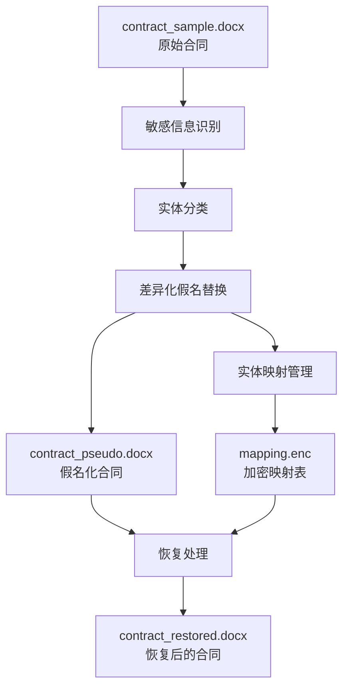
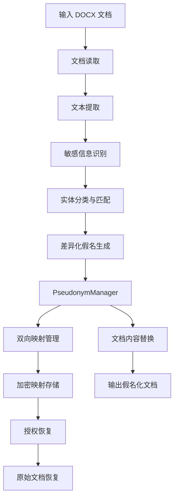
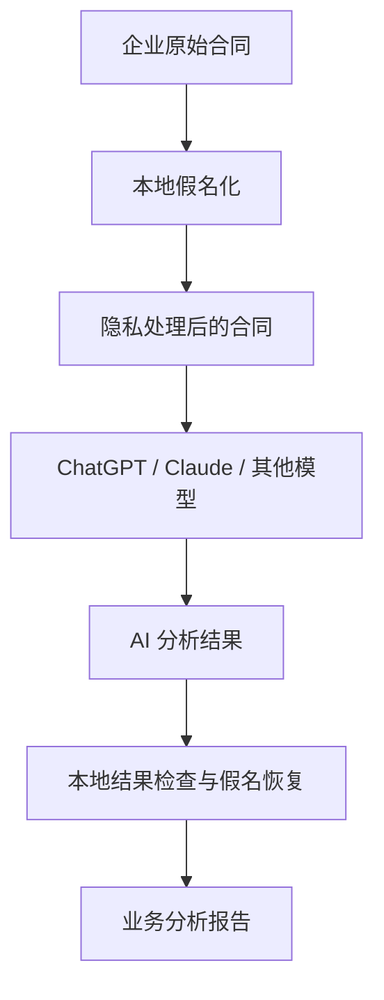

# 面向中文文档的可逆数据假名化与隐私保护工具

对文档中的敏感实体进行自动识别、差异化假名替换与加密映射，在降低真实身份信息暴露风险的同时，保留文档的业务语义、实体关联性和原始数据恢复能力。

---

## 1. 项目简介

一个基于 Python 开发的中文文档隐私保护工具，主要用于对 Word 文档中的个人身份信息、企业信息和业务敏感数据进行自动化假名化处理，并支持通过加密映射关系恢复原始数据。

在合同、企业协议、商务文件和业务报告中，通常包含大量敏感信息，例如：

- 自然人姓名及联系方式。
- 企业名称及统一社会信用代码。
- 身份证号码。
- 手机号码和电子邮箱。
- 企业注册地址及业务地址。
- 银行开户行及其他机构信息。

这些信息在文档共享、外部审查、AI 大模型分析和开发测试过程中，可能造成个人隐私泄露或企业商业信息暴露。

传统的星号遮盖方式虽然能够隐藏部分信息，但容易破坏文档中的实体关联关系，也不方便后续恢复。

本项目采用 **可逆假名化（Reversible Pseudonymization）** 技术，将真实敏感信息替换为具有一定业务语义的虚拟信息，并通过映射机制维持实体之间的一致性。

### 核心设计目标

| 目标 | 实现方式 |
|---|---|
| 敏感信息保护 | 自动识别并替换文档中的敏感实体 |
| 实体一致性 | 相同实体在文档中使用相同假名 |
| 差异化替换 | 根据敏感信息类别采用不同替换策略 |
| 业务语义保留 | 尽量保留文档的业务结构和可读性 |
| 可逆恢复 | 通过双向映射恢复原始信息 |
| 映射安全 | 使用 Fernet 加密保护映射数据 |

**项目定位：面向中文业务文档的可逆假名化与隐私保护工具。**

---

## 2. 核心功能

### 2.1 敏感信息自动识别

项目结合正则表达式和中文分词技术，对文档中的敏感实体进行识别与分类。

目前覆盖七类主要敏感信息：

| 类型 | 标识 | 处理对象 |
|---|---|---|
| 姓名 | NAME | 自然人姓名 |
| 身份证号 | ID | 身份证号码 |
| 手机号 | PHONE | 手机号码 |
| 邮箱 | EMAIL | 电子邮箱 |
| 地址 | ADDRESS | 个人及企业地址 |
| 机构名称 | ORG | 企业、组织及机构名称 |
| 统一社会信用代码 | USCC | 企业统一社会信用代码 |

识别技术：

- 正则表达式：识别具有固定格式的号码和邮箱等信息。
- jieba：辅助处理中文文本和实体识别。
- 实体分类：根据不同敏感信息类别执行对应的替换策略。

### 2.2 差异化假名替换

本项目不是简单地将所有敏感信息替换为 `******`，而是根据不同类型的实体采用差异化替换方式。

例如：

| 敏感信息类型 | 原始内容 | 假名化结果 |
|---|---|---|
| 企业名称 | 北京某科技有限公司 | 某公司1 |
| 企业名称 | 上海某数据有限公司 | 某公司2 |
| 姓名 | 欧阳明 | 欧阳某1 |
| 姓名 | 覃晓明 | 覃某2 |
| 手机号 | 真实手机号码 | 虚拟手机号码 |
| 邮箱 | 真实邮箱地址 | user1@example.com |
| 地址 | 北京市海淀区某路1号 | 某市某区某路1号 |
| 开户行 | 真实银行网点名称 | 某公司3 |
| 统一社会信用代码 | 真实信用代码 | 虚拟代码 |

以上为项目演示效果，具体生成规则和结果以实际处理为准。

不同类型的信息采用不同策略：

**姓名：部分遮蔽**

保留部分姓名特征，以降低身份信息暴露程度，同时保持文档可读性。

例如：

```text
欧阳明 -> 欧阳某1
覃晓明 -> 覃某2
司马光 -> 司马某6
```

**企业名称：统一假名化**

将真实企业名称替换为带编号的虚拟企业名称。

```text
北京智源人工智能研究院有限公司 -> 某公司1

上海云帆数据科技有限公司 -> 某公司2
```

**联系方式：虚拟数据替换**

将真实电话号码和电子邮箱替换为虚拟数据。

```text
真实手机号 -> 13800000001

真实邮箱 -> user1@example.com
```

**地址：泛化处理**

将真实地理位置替换为泛化地址。

```text
北京市海淀区中关村东路1号院8号楼

↓

某市某区某路1号
```

**机构及企业标识：虚拟化处理**

将银行开户行、统一社会信用代码等信息替换为虚拟内容，降低企业身份和业务信息泄露风险。

### 2.3 实体一致性管理

这是本项目的重要设计。

在合同中，同一个企业或自然人通常会在多个位置重复出现。

例如：

```text
甲方：北京智源人工智能研究院有限公司

法定代表人：欧阳明

授权代表：欧阳明
```

假名化之后：

```text
甲方：某公司1

法定代表人：欧阳某1

授权代表：欧阳某1
```

系统通过统一的实体映射关系，确保相同实体在同一映射上下文中保持一致。

其价值包括：

- 保持合同主体与签章信息之间的关联。
- 保持联系人与业务角色之间的对应关系。
- 避免同一个实体被重复替换成不同假名。
- 保留文档的基本业务逻辑。

### 2.4 双向映射与原始数据恢复

项目采用双向映射机制维护真实信息与假名之间的关系。

```text
真实实体                  假名实体

北京智源人工智能研究院有限公司
             <->
          某公司1

欧阳明
             <->
          欧阳某1

13800001234
             <->
        虚拟手机号
```

处理过程分为两个方向：

```text
Anonymization:

真实文档 -> 敏感信息识别 -> 假名替换 -> 假名化文档


Restoration:

假名化文档 -> 映射查询 -> 原始信息恢复 -> 原始文档
```

通过受保护的映射关系，系统可以将处理后的文档恢复为原始内容。

### 2.5 加密映射表

为了保护真实信息与假名之间的对应关系，项目使用 Python `cryptography` 库提供的 Fernet 加密机制。

典型数据文件：

```text
data/
├── mapping.enc
└── key.bin
```

其中：

- `mapping.enc`：加密后的实体映射数据。
- `key.bin`：用于加密和解密的密钥。

安全设计：

- 映射关系不以普通明文形式存储。
- 使用加密机制保护映射文件。
- 密钥与映射文件分开存储。
- 审计日志避免记录原始敏感文本。
- 恢复操作需要访问相应的映射数据和密钥。

---

## 3. 实际处理效果

本项目提供了一组完整的 Word 合同处理示例：

| 文件 | 作用 |
|---|---|
| contract_sample.docx | 原始合同 |
| contract_pseudo.docx | 假名化处理后的合同 |
| contract_restored.docx | 恢复后的合同 |

### 3.1 原始合同

原始合同包含：

- 甲乙双方企业名称。
- 统一社会信用代码。
- 企业注册地址。
- 法定代表人及联系人。
- 联系电话和电子邮箱。
- 项目负责人信息。
- 银行开户行。
- 验收联系人。
- 保密对接人。

### 3.2 假名化后的合同

经过处理后：

```text
技术服务合同

甲方（委托方）：某公司1

统一社会信用代码：虚拟信用代码

住所地：某市某区某路1号

法定代表人：欧阳某1

联系人：覃某2

联系电话：虚拟手机号

电子邮箱：user1@example.com


乙方（受托方）：某公司2

统一社会信用代码：虚拟信用代码

住所地：某市某区某路2号

法定代表人：冼某4

联系人：张某5

联系电话：虚拟手机号

电子邮箱：user2@example.com
```

其他合同条款、金额、交付时间和业务描述仍然保留。

同时，甲方、乙方、法定代表人等重复出现的实体保持相同的假名。

### 3.3 恢复后的合同

使用原有映射关系执行恢复操作，系统将假名替换回真实信息。

本次演示中，恢复后的合同文本与原始合同文本一致，包括：

- 企业名称。
- 自然人姓名。
- 联系电话。
- 电子邮箱。
- 统一社会信用代码。
- 地址及银行开户行。
- 项目负责人和验收联系人信息。

这验证了本次样例处理中的双向恢复效果。

### 3.4 完整处理流程



---

## 4. 系统架构

项目采用模块化设计，主要由敏感信息识别、实体映射、加密存储、文档处理和操作入口组成。

### 4.1 核心处理架构



### 4.2 核心模块

| 模块 | 主要职责 |
|---|---|
| 敏感信息识别模块 | 识别姓名、企业名称、电话、地址等 |
| 实体分类模块 | 根据敏感信息类别选择处理策略 |
| PseudonymManager | 管理假名生成及双向映射 |
| 文档处理模块 | 读取、修改和保存 Word 文档 |
| 加密存储模块 | 加密、读取及管理映射文件 |
| 审计模块 | 记录脱敏及恢复操作 |
| CLI 模块 | 提供命令行操作入口 |
| GUI 模块 | 提供图形化操作入口 |

### 4.3 技术栈

| 技术 | 用途 |
|---|---|
| Python 3.10+ | 核心开发语言 |
| python-docx | Word 文档处理 |
| jieba | 中文分词 |
| cryptography | 加密与密钥处理 |
| PyMuPDF | PDF 相关处理依赖 |
| pytest | 自动化测试 |

---

## 5. 应用场景

### 5.1 合同共享与外部审查

企业在向律师、合作伙伴或第三方机构共享合同之前，可以先对合同中的敏感信息进行假名化。

外部人员仍然可以阅读：

- 合同主体关系。
- 项目交付内容。
- 合同金额。
- 付款条款。
- 违约责任。
- 保密义务。

但不必直接获得真实身份信息。

### 5.2 AI 大模型隐私保护

本项目可以作为企业使用外部大模型之前的本地文档预处理工具。



例如：

```text
原始内容：

张三与某科技公司签署采购合同。

假名化：

张某1与某公司1签署采购合同。
```

这样可以减少真实身份信息直接发送到外部 AI 服务的情况。

注意：本项目本身并未内置 AI API 网关。上述场景需要进一步集成模型请求处理和响应检查机制。

### 5.3 开发测试数据保护

开发人员可以使用假名化后的合同进行功能开发、测试和调试，减少直接接触真实个人信息的需要。

### 5.4 企业内部数据共享

企业可以在内部业务协作、合同审查和数据研究过程中使用假名化文档，在保留必要业务关联性的同时降低敏感信息暴露风险。

---

## 6. 安装指南

### 环境要求

- Python 3.10 或更高版本。
- Windows、macOS 或 Linux。
- pip 包管理工具。

### 克隆项目

```bash
git clone https://github.com/Marcel-HZ/Project-Dynamic-Data-Masking.git

cd Project-Dynamic-Data-Masking
```

### 创建虚拟环境

Windows：

```bash
python -m venv .venv

.venv\Scripts\activate
```

macOS / Linux：

```bash
python3 -m venv .venv

source .venv/bin/activate
```

### 安装依赖

```bash
python -m pip install --upgrade pip

pip install -e .
```

---

## 7. 使用指南

项目提供命令行和图形化操作方式。

### 7.1 命令行模式

假名化：

```bash
pseudo-tool anonymize sample.docx out.docx
```

恢复：

```bash
pseudo-tool restore out.docx back.docx
```

清理映射数据：

```bash
pseudo-tool clear
```

清理操作可能导致原始数据无法恢复，请提前备份映射数据和密钥。

### 7.2 GUI 模式

启动图形界面：

```bash
pseudo-tool-gui
```

GUI 适合需要直接选择文档、执行假名化和恢复操作的用户。

具体命令以项目当前安装入口配置为准。

---

## 8. 项目目录结构

```text
Project-Dynamic-Data-Masking/
│
├── src/
│   └── pseudo_tool/
│       ├── main.py
│       └── ...
│
├── tests/
│   └── ...
│
├── data/
│   ├── mapping.enc
│   └── key.bin
│
├── contract_sample.docx
│
├── pyproject.toml
├── requirements.txt
├── README.md
└── .gitignore
```

---

## 9. 数据安全设计

### 9.1 映射数据加密

使用 Fernet 对映射数据进行加密，保护真实实体与假名之间的对应关系。

### 9.2 密钥保护

生产环境建议：

- 将密钥存放在独立安全存储位置。
- 限制密钥文件的读取权限。
- 避免将密钥提交到 Git 仓库。
- 建立密钥备份和轮换机制。
- 对恢复操作增加身份认证与授权。

### 9.3 假名化不等于匿名化

这是本项目非常重要的安全边界。

由于系统保留了真实数据与假名之间的映射关系，处理后的文档仍然可能在特定条件下重新识别个人或企业。

因此：

- 假名化文档仍应按照敏感数据进行管理。
- 映射文件和密钥必须严格保护。
- 不能将假名化结果直接视为完全匿名的数据。
- 对外共享前应检查文档上下文是否存在间接身份泄露。
- 应根据实际用途进行合规评估。

---

## 10. 当前能力与局限性

| 能力 | 当前状态 |
|---|---|
| 中文敏感信息识别 | 已提供 |
| 姓名假名化 | 已提供 |
| 企业名称假名化 | 已提供 |
| 手机号替换 | 已提供 |
| 邮箱替换 | 已提供 |
| 地址泛化 | 已提供 |
| 统一社会信用代码替换 | 已提供 |
| 实体一致性管理 | 样例已验证 |
| 双向映射恢复 | 样例已验证 |
| 映射表加密 | 已提供 |
| Word 合同处理 | 已提供 |
| PDF 完整脱敏 | 尚待验证 |
| Excel 脱敏 | 尚待开发 |
| 数据库动态脱敏 | 尚不支持 |
| AI API 自动代理 | 尚不支持 |
| 企业级权限管理 | 尚待开发 |

## 11. 测试

执行自动化测试：

```bash
pytest -q
```

## 12. 免责声明

本项目主要用于技术研究、文档隐私保护和数据安全实践。

假名化不能保证完全消除重新识别风险，也不能替代企业数据安全制度、专业安全评估和法律合规审查。

请确保在具有相应数据处理权限的前提下使用本项目。